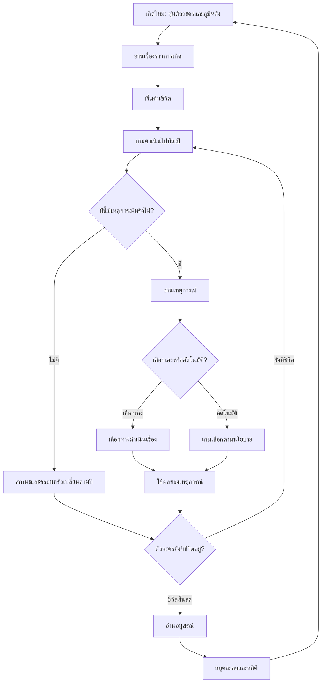

# ชีวิต

**ชีวิต** คือเกมจำลองชีวิตภาษาไทยที่พาเราไปติดตามคนคนหนึ่ง ตั้งแต่วันที่เกิดในภาคอีสาน ผ่านเรื่องราวและการตัดสินใจในแต่ละช่วงวัย จนถึงหน้าสุดท้ายของชีวิต

ตัวละครและจุดเริ่มต้นถูกสุ่มขึ้นใหม่ทุกครั้งที่เกิด เหตุการณ์อาจเปิดทางเลือกให้ตัดสินใจ หรือผ่านไปอย่างเรียบง่าย การเลือกและเหตุการณ์จะส่งผลต่อสุขภาพ ความเป็นอยู่ ความรู้ ความสัมพันธ์ และชีวิตของครอบครัว

## วิธีเล่น

1. เลือก **เกิดใหม่** เพื่อสุ่มตัวละครและดูเรื่องราวการเกิด
2. เริ่มชีวิต แล้วอ่านเหตุการณ์ที่ปรากฏในแต่ละปี เลือกทางที่ต้องการ หรือเปิดโหมดอัตโนมัติให้เกมเลือกแทน
3. ใช้ปุ่มควบคุมเวลาเพื่อหยุด ปรับความเร็ว หรือเดินหน้าไปยังการตัดสินใจครั้งถัดไป
4. ดูเรื่องราวและสถานะของตัวละคร ครอบครัว และคนที่พบระหว่างทาง
5. เมื่อชีวิตสิ้นสุด อ่านอนุสรณ์ แล้วเริ่มชีวิตใหม่ได้

เกมมีสมุดสะสมผู้คนและหน้าสถิติการจากไปให้กลับมาดูได้ ความคืบหน้าและสมุดสะสมบันทึกไว้ในเบราว์เซอร์เครื่องนี้

## วงจรการทำงานของเกม

โลกที่แสดงจำนวนชีวิตและการเกิดใหม่เป็นการจำลองของเกม ไม่ใช่ข้อมูลจากผู้เล่นคนอื่น เกมรุ่นนี้เก็บข้อมูลไว้ในเบราว์เซอร์และไม่มีเซิร์ฟเวอร์

## เอกสารสำหรับผู้พัฒนา

คำแนะนำการติดตั้งและรันโปรเจกต์ โครงสร้างระบบ วิธีเพิ่มเนื้อหา แนวทางตรวจสอบข้อมูล และการเผยแพร่อยู่ใน [เอกสารสำหรับผู้พัฒนา](docs/DEVELOPMENT.md)

## เครดิต

- ฟอนต์ PS Pimpdeed โดย touchie ([หน้าฟอนต์](https://www.f0nt.com/release/ps-pimpdeed-family/))
- ฟอนต์ Tlwg Typist โดย Thai Linux Working Group
- ชื่อตำบลและอำเภอมาจากชุดข้อมูล MIT-licensed [kongvut/thai-province-data](https://github.com/kongvut/thai-province-data) รายละเอียดแหล่งข้อมูลและวันที่ snapshot อยู่ใน [`src/content/data/SOURCES.md`](src/content/data/SOURCES.md) ชื่อหมู่บ้านในเรื่องเกิดเป็นชื่อสมมติที่นำมาผสมกัน
